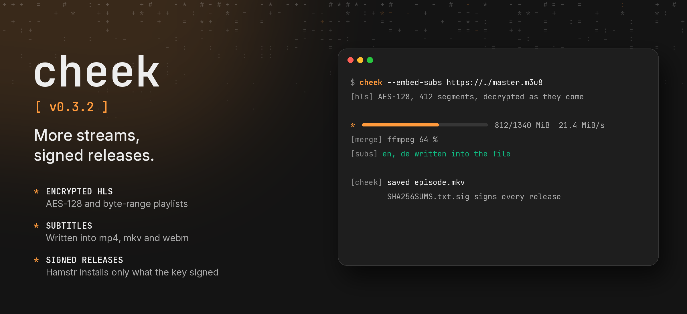

cheek 0.3.2 opens more HLS streams, embeds subtitles and signs its releases.

- HLS segments encrypted with AES-128 are decrypted as they arrive; byte-range playlists fetch their pieces of one file. SAMPLE-AES and DRM schemes stay unsupported.
- A playlist without an end tag is checked once more; a live stream that keeps growing is reported as such instead of downloading only its current window. Loading a playlist is retried when the server hiccups.
- `--embed-subs` and `--sub-langs` write the site's subtitles (from yt-dlp's JSON) into mp4, mkv and webm.
- `--info-json` takes yt-dlp's flat playlists and downloads their videos one after another; `done` events name each video and its playlist.
- ffmpeg reports its progress as `stage_progress` events while merging, converting and tagging.
- A download whose merge failed keeps its finished streams, so running it again only merges.
- `--resolve-timeout` stops a yt-dlp that never answers (180 s by default). A server's `Retry-After` is honored up to 60 s.
- A `+` in a file link's name stays a plus.
- `SHA256SUMS.txt` comes with `SHA256SUMS.txt.sig`, signed with cheek's release key; Hamstr installs only signed updates.

Includes Linux, Windows, macOS and all three Android binaries. Verify downloads against `SHA256SUMS.txt` and its signature.
