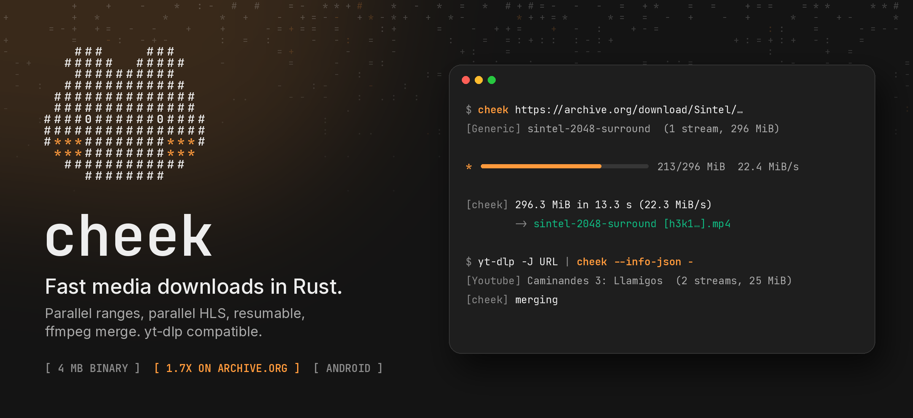

<p align="center">
  
</p>

<p align="center">
  <a href="https://github.com/Mailo037/cheek/releases/latest"></a>
  <a href="https://github.com/Mailo037/cheek/actions/workflows/ci.yml"></a>
  
  <a href="LICENSE"></a>
</p>

**cheek** downloads media fast. It is a single Rust binary of about 4 MB. It splits each file into byte ranges and fetches them over many connections at once. HLS segments also download in parallel. Interrupted downloads continue where they stopped, and video and audio are merged with ffmpeg without re-encoding. It is the download engine of [Hamstr](https://github.com/Mailo037/Hamstr) and works on its own on Linux, Windows, macOS and Android.

## Where the speed comes from, and where it doesn't

A download has two halves. **Resolving** works out which streams a link has and where they live. **Fetching** moves the bytes.

- **Fetching is where cheek wins.** A single HTTP connection rarely fills a fast line: TCP ramps up slowly, and many CDNs pace each connection. Eight connections that each pull their own range fill the line instead.
- **Resolving stays with [yt-dlp](https://github.com/yt-dlp/yt-dlp).** It has extractors for more than 1,800 sites, and maintainers fix them every week as the sites change. A rewrite would fall behind within days. So for YouTube, Instagram, TikTok and the like, cheek reads yt-dlp's JSON and takes over from there.
- **Direct links, HLS playlists and ordinary web pages** (`og:video`, `<video>`, JSON-LD) are resolved by cheek alone, with no Python involved.

## Benchmarks

<!-- bench:start -->
| Download | Size | yt-dlp | cheek | Speed-up |
| --- | ---: | ---: | ---: | ---: |
| Sintel 2K, archive.org (far away, paced per connection) | 296 MiB | 22.7 s | 13.3 s | **1.7x** |
| Sintel 1080p, download.blender.org (direct file) | 1125 MiB | 36.6 s | 30.3 s | **1.2x** |
| Sintel, YouTube 1080p + audio | 180 MiB | 8.3 s | 8.2 s (incl. 2.7 s yt-dlp -J) | **1.0x** |
| Caminandes 3, YouTube 1080p + audio | 25 MiB | 3.4 s | 3.3 s (incl. 2.4 s yt-dlp -J) | **1.0x** |

Windows 11 on a ~300 Mbit/s line, yt-dlp 2026.10.26 with its default single connection, cheek 0.1.0 with 8, best of 2 runs each, same formats on both sides, MD5 checked against Blender's published sum. yt-dlp ran with `--no-check-certificates` for the two non-YouTube hosts, because its Python TLS stack rejects their certificate chains (curl and cheek accept them); that doesn't change its speed.

**What this means:** cheek wins where one connection can't fill the line, for example a server far away or a host that limits each connection. Archive.org, many CDNs and mobile networks behave like that. On a fast line close to a fast server (YouTube from Europe here), a single connection already runs at full speed, and both tools are as fast as the line allows.
<!-- bench:end -->

Run them yourself with `python bench/bench.py --yt-dlp yt-dlp --ffmpeg ffmpeg --cheek target/release/cheek`. The YouTube rows include the time `yt-dlp -J` needs to resolve the link.

## Use

```bash
# A direct file, an HLS playlist or a page with a video on it
cheek https://example.com/talk.mp4

# Any site yt-dlp knows; cheek calls yt-dlp to resolve the link when it's installed
cheek "https://www.youtube.com/watch?v=SkVqJ1SGeL0" -f "bv*[height<=1080]+ba/b"

# Or hand over yt-dlp's JSON yourself
yt-dlp -J -f "bv*+ba/b" URL | cheek --info-json -

# Sound only, without re-encoding when the source is already Opus or AAC
cheek -x URL
cheek -x --audio-format mp3 URL
```

| Option | Default | |
| --- | --- | --- |
| `-N, --connections` | `8` | Requests in flight at once |
| `--chunk-size` | `8M` | Largest byte range per request; capped by the host's own limit |
| `-o, --output` | `%(title)s [%(id)s].%(ext)s` | yt-dlp's template syntax (`title`, `id`, `ext`, `extractor`, `uploader`, `.NB` to cut) |
| `-P, --paths` | `.` | Folder for finished files |
| `--temp-dir` | output folder | Where `.part` files wait |
| `-f, --format` | `bv*+ba/b` | yt-dlp format selector, used when yt-dlp resolves |
| `--resolver` | `auto` | `auto`: cheek first, yt-dlp for the big sites; `native` or `yt-dlp` to force one |
| `-x`, `--audio-format` | `best` | Keep only the sound: `best`, `opus`, `m4a`, `mp3`, `flac`, `wav` |
| `--merge-output-format` | picked like yt-dlp | `mp4`, `mkv` or `webm` when video and audio are joined |
| `--json` | | One JSON event per line on stdout, for apps |
| `-J, --dump-json` | | Print what would be downloaded and stop |

Press Ctrl+C and the `.part` file stays, together with a small `.cheek` note of the chunks that are done. Running the same command again continues from there.

### JSON events

With `--json`, every line on stdout is one event:

```json
{"type":"info","id":"SkVqJ1SGeL0","title":"Caminandes 3: Llamigos","extractor":"Youtube","streams":2,"size":26214400}
{"type":"progress","downloaded":10485760,"total":26214400,"percent":40.0,"speed":31457280,"eta":1}
{"type":"stage","stage":"merging"}
{"type":"done","path":"Caminandes 3： Llamigos [SkVqJ1SGeL0].mp4","bytes":26214400,"seconds":1.2}
```

When something fails, the last line is `{"type":"error","message":"..."}` and the exit code is 1. An interruption exits with 130.

## Install

Download a binary from the [latest release](https://github.com/Mailo037/cheek/releases/latest):

| File | For |
| --- | --- |
| `cheek-x86_64-linux`, `cheek-aarch64-linux` | Linux (static, musl) |
| `cheek-x86_64-windows.exe` | Windows |
| `cheek-aarch64-macos`, `cheek-x86_64-macos` | macOS |
| `cheek-android-arm64-v8a`, `-armeabi-v7a`, `-x86_64` | Android apps that ship it as `libcheek.so` |

Or build it:

```bash
cargo install --git https://github.com/Mailo037/cheek
```

ffmpeg is only needed for merging, audio extraction and HLS remuxing; a single-file download works without it. yt-dlp is only needed for the sites cheek doesn't resolve by itself.

### Android

```bash
cargo ndk -t arm64-v8a -t armeabi-v7a -t x86_64 --platform 26 build --release
```

TLS uses rustls with bundled Mozilla roots, so the binary runs as a plain process inside an app, with no JNI. Hamstr packs it as `libcheek.so`; the system extracts it next to the app's other native libraries and the app runs it from there.

## How it works

```
 link ─┬─ direct file / HLS / web page ──► cheek's own extractor ─┐
       └─ YouTube, Instagram, TikTok ... ─► yt-dlp -J (JSON) ─────┤
                                                                  ▼
                               streams (video, audio) with URLs and headers
                                                                  │
          probe: size + range support ◄───────────────────────────┤
                                                                  ▼
     ranges ──► N workers ──► write at offset ──► .part + .cheek (resume notes)
     HLS    ──► segments in parallel ──► written in order
                                                                  │
                                         ffmpeg -c copy (merge / remux / audio)
                                                                  ▼
                                                            finished file
```

- `src/download.rs`: ranged downloads. Chunk sizes adapt so that every connection stays busy to the end. Failed ranges retry with backoff, without counting their bytes twice.
- `src/hls.rs`: master and media playlists, init segments, parallel segments written in order.
- `src/extract/`: the generic extractor and the yt-dlp JSON reader.
- `src/merge.rs`: ffmpeg calls that copy streams; they only re-encode when you ask for a different audio format.

## License

[Unlicense](LICENSE), public domain, like yt-dlp.
